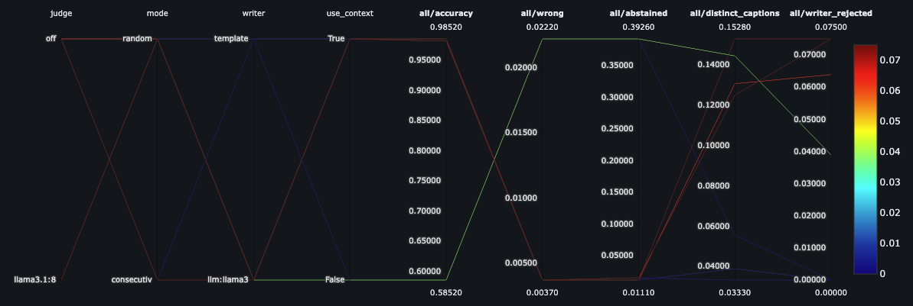
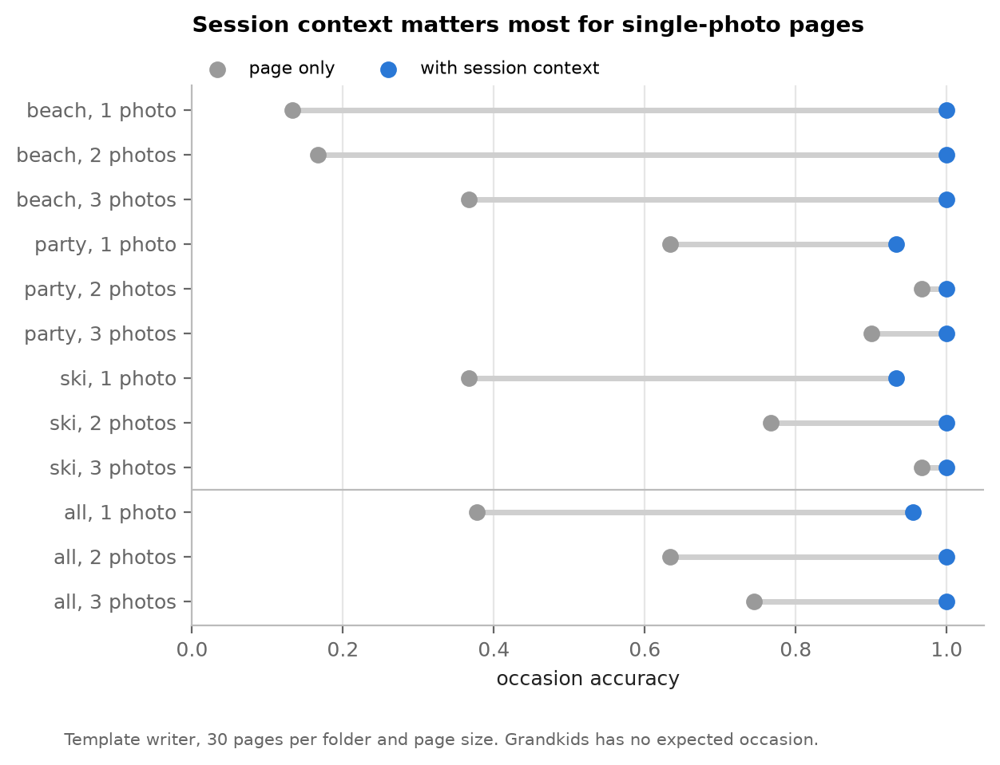
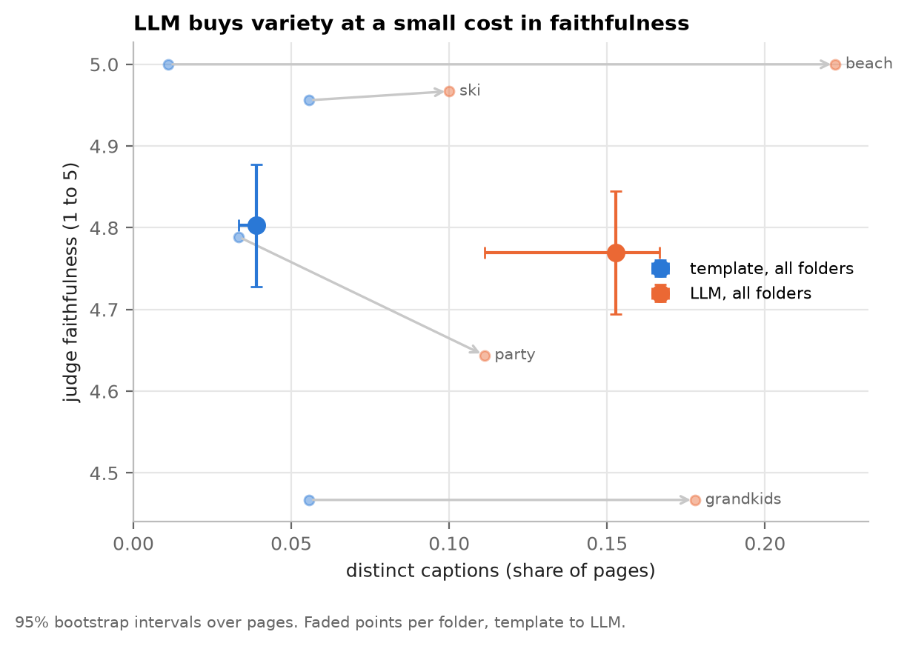
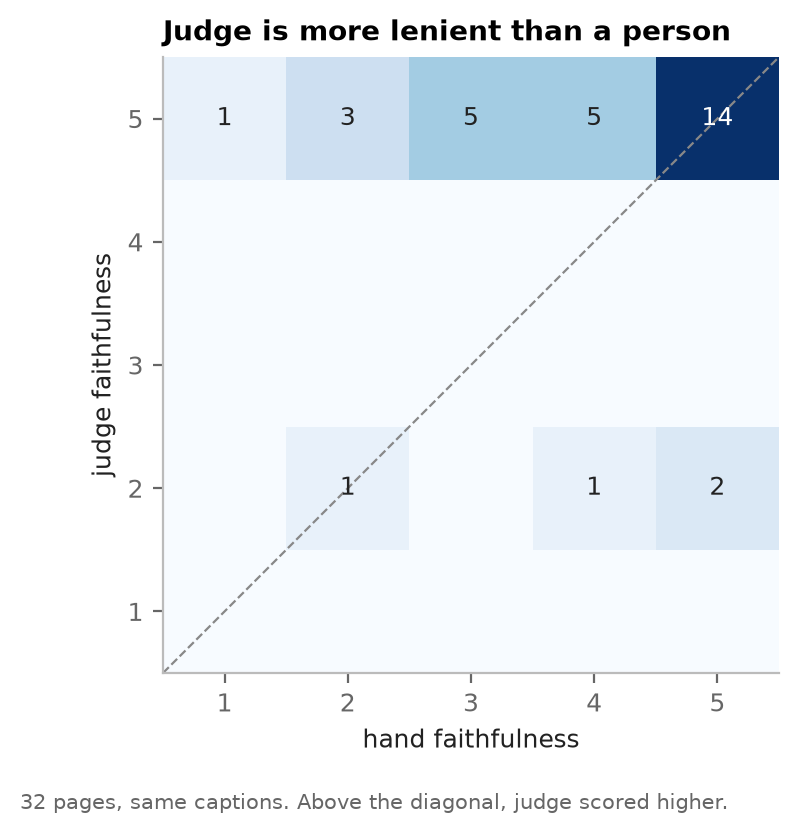
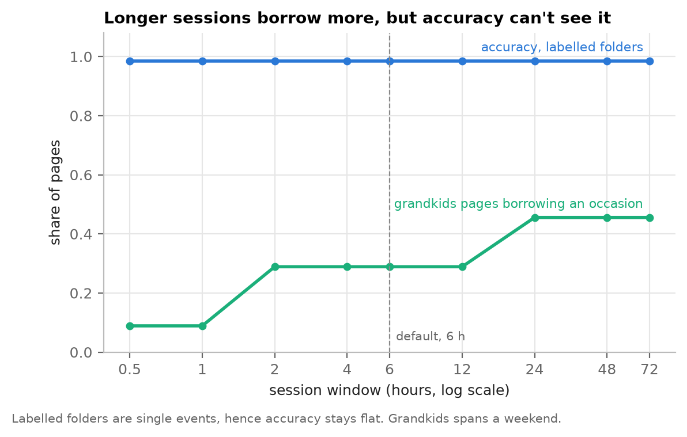
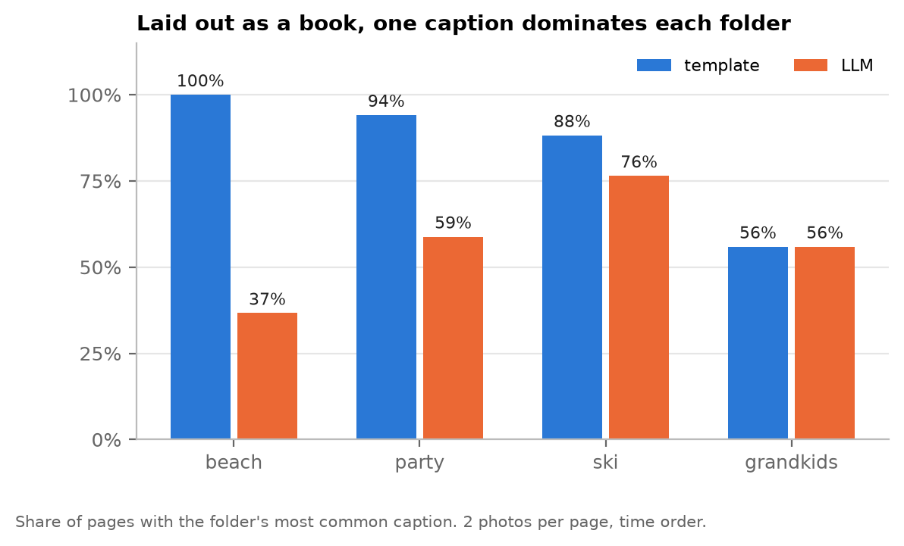

# Photobook captioner - Write-up and analysis

## Summary

Captions for photobook pages of 1 to 3 photos, which are constructed from photo metadata and scene labels rather than from the pixels directly. The proposed pipeline extracts facts first (i.e. date, place, occasion), then words them either with a deterministic template by default, or by utilising a small local LLM for variety. Worth noting that it checks every LLM caption against the facts before it can be used.

The main results, for four sample folders:

- Session context appears to be the main driver of accuracy. Pages that may borrow evidence from photos taken around the same time reach approximately 0.98 occasion accuracy, against 0.59 on their own photos. Wrong occasions stay under 1%.
- The template and LLM writers are equally accurate. The LLM gives about 4 times the variety for a small yet relatively measurable cost in faithfulness.
- The main weakness is repetition across a book, whereby a single caption dominates each folder. Fix belongs above the page, captioning per section as opposed to per page.

Everything runs offline, at minimal cost, and no photo leaves the machine.

## 1. Exploration

Further detail situated in `notebooks/01_exploration.ipynb`.

Individual photos come with EXIF and a label file of scene labels with confidences. The capture dates and GPS are present for the majority of photos, hence date and place can be stated as facts. Labels are noisier - they name objects well, yet provide minimal information about people or occasions, and a single photo often carries no occasion specific label at all. A good example is that a close up of two people on a beach is labelled as people and clothing, not as a beach.

Folders contain bursts of almost identical photos, hence initial sampling removes near duplicates first (difference hash), so the same evidence isn't counted twice. Three folders are single events. Grandkids folder covers a weekend of different activities and has no single expected occasion, which makes it the useful stress test for anything that borrows evidence across photos.

The initial exploration stage led to three major design constraints. Facts that are reliable should be stated exactly. Occasion should only be named when evidence supports it. And a single page needs help from the photos situated around it.

## 2. Approaches considered

Options are directly compared and discussed in `notebooks/02_approaches.ipynb`:

- Vision-language model that captions photos directly. The most fluent, yet sees pixels only, hence it cannot know the date or the location, has a propensity to invent detail, and sends every photo to a model. Raises both cost and privacy concerns.
- Cloud LLM over labels and metadata. Grounded in facts, yet still an issue with per page API cost and latency, and still free to invent.
- Specified rules and a template over both labels and metadata. Grounded, free, instant and deterministic, but repetitive.

The chosen design is effectively facts first and then wording. Every claim in a caption traces back to EXIF or a label, runs offline, and the wording step is swappable. Template method is the default and a local LLM is the option for variety. Both pass the same validation criteria. A vision model can be implemented later as one more source of facts, behind the same validator, as opposed to acting as the writer.

The main guiding principle is that a printed caption can't be corrected. An invented detail is worse than a plain caption, hence the system abstains rather than guesses.

## 3. Design and implementation specifics

```
photos -> EXIF + labels -> page facts -> writer -> validator -> caption
```

Facts: Capture time and GPS come directly from EXIF. GPS is reverse geocoded offline to a location/town, with the country added when outside the user's home country. Labels are scored against occasion rules situated in `src/captioner/occasions.toml`, which hold label specific evidence weights, main labels that must be present, blocking labels that rule an occasion out, and expected setting alongside season.

Session context: A weak page may borrow an occasion from other photos taken within specified 6 hours and 25 km, yet only if session evidence is relatively clear, the page setting is compatible and nothing on the page blocks it. Strong page evidence will always override the session.

Writers: The template has two shapes, trips ("Skiing holiday in Yuzawa, Japan, February 2020") and single day occasions ("7th February 2019 – Birthday party"). The LLM writer (Llama 3.2 3B via Ollama) only ever sees a few words of text (occasion, place, season, setting and a few flags) and never the actual photos or dates. The date is added back afterwards. Pages with no occasion are set to skip the model entirely.

Validation: Every LLM caption is subsequently checked against the facts and hence rejected if it introduces years, months, days, proper nouns, people, or scene details that the facts do not support. Rejected captions will fall back to the template.

Packaging and tooling: The package is strictly typed with 140 tests and 94% line coverage (CI doesn't install PyTorch - CLIP gap). CI runs lint, type checks and tests, then builds the Docker image and checks that API captions a photo. Captioner is available as a Python function (`generate_caption`), a CLI, an HTTP API and a versioned MLflow model. Evaluation runs are logged to MLflow with config, commit and outputs. Aim is to ensure full traceability.



Figure above displays final evaluation runs in MLflow, one line per run, from settings through to metrics. Session context is what separates high from low accuracy, while writer mainly moves variety and rejections.

## 4. Evaluation criteria

No reference captions exist, hence evaluation relies on checks that don't require them:

- Occasion - folder names used as weak labels, with each page scored right, wrong or abstained.
- Grounding - years in each caption checked against EXIF, independently of the validator.
- Variety - share of distinct captions, since a book repeating one caption reads badly.
- LLM judge - a larger local model (Llama 3.1 8B) scores faithfulness, specificity and naturalness from 1 to 5, given the facts and detected labels.
- CLIP - image-text similarity of caption against photos.
- Manual review - 32 pages rated by hand for faithfulness and naturalness.

Each run samples 90 pages per folder (30 each of 1, 2 and 3 photos), 360 in total. The final runs share both code and sampled pages, hence are directly comparable. Full analysis situated in `notebooks/03_results.ipynb`.

### Main results

| Run | Accuracy | Wrong | Abstained | Distinct captions | LLM rejected | Judge faithful |
|---|---|---|---|---|---|---|
| Template, page only | 0.59 | 2.2% | 39.3% | 5.6% | - | - |
| Template, with context | 0.98 | 0.4% | 1.1% | 3.9% | - | 4.80 |
| Template, with context, consecutive pages | 0.98 | 0.4% | 1.5% | 3.3% | - | - |
| LLM, page only | 0.59 | 2.2% | 39.3% | 14.4% | 3.9% | - |
| LLM, with context | 0.98 | 0.4% | 1.1% | 15.3% | 7.5% | 4.77 |
| LLM, with context, consecutive pages | 0.98 | 0.4% | 1.5% | 12.5% | 7.5% | - |

360 pages per run (270 with an expected occasion). Judge scored on context runs only. Manual review of 32 LLM captions gave 4.0 for faithfulness and 3.6 for naturalness, out of 5.

### Session context



Context lifts accuracy from 0.59 to 0.98, with bootstrap interval for the gain of 0.34 to 0.46. Mainly from cutting abstentions, from 39% to approximately 1%. Wrong occasions also drop, from 2.2% to 0.4%. The gain here is largest on single photo pages, 0.38 to 0.96, as one photo rarely shows occasion. A prime example to consider is the beach folder, where single photo pages go from 0.13 to 1.00. Consecutive pages, which are closer to a real book, behave the same as random ones.

### Template against LLM



Both writers share same facts and hence are equally accurate. The LLM provides about 4 times the variety (15% distinct captions against 4%) at slightly lower judge faithfulness, 4.77 against 4.80. The paired difference is 0.03, with an interval of 0.01 to 0.05, hence the cost is small yet real. It is worth noting that the cost comes almost entirely from the party folder, while beach, ski and grandkids stay level. The validator rejects 7.5% of LLM captions, all of them for scene words. CLIP sees no difference between writers, which is to be expected for captions built from the same facts.

Initially implemented version of the validator only checked capitalised words. Adding a scene word list raised judge faithfulness of LLM captions from 4.64 to 4.75, at a slight cost in variety, since rejected captions become template captions.

### Manual review against the judge



Manual review gave 4.0 for faithfulness and 3.6 for naturalness, with 69% and 47% of pages at 4 or above. The judge gave 5 to 28 of the 32 pages, including pages rated 1 to 3 by hand. The judge sees facts and label names yet not the photos. It is useful for catching unsupported words and comparing runs at scale, as opposed to measuring truth. Manual review remains the reference, albeit a single reviewer done quickly within the time available, hence best treated as indicative.

### Failure cases

The lowest manual scores fall into four kinds, each with a different fix:

- Invented scene - a sunny garden party captioned "in the snow". Fixed by the scene word list.
- Borrowed occasion - a child with ketchup on the sofa captioned "Baking", borrowed from baking photos taken the same afternoon.
- Wrong label - adult skiers labelled as kids for example, so "with kids" passes the validator.
- Mixed dates - photos from one party carry different EXIF years, hence "2018–2019".

### Sensitivity

Settings were based on reasoning about the labels as opposed to being tuned on these photos, as practically there are too few to tune on without overfitting. Varying each setting on its own shows that defaults sit on a wide plateau. Accuracy only drops when thresholds are pushed far from defaults, hence the results are robust to the exact choice of settings.



The session window behaves differently from the other settings. Accuracy is flat from half an hour to three days, since each labelled folder is a single event. Yet the share of grandkids pages borrowing an occasion goes from 9% to 29% to 46% as the window grows, and many of those borrowed occasions don't actually fit the page. A specific risk that accuracy alone cannot see.

### Repetition



Laid out as a book (2 photos per page, in time order), a single template caption covers 88 to 100% of pages in each single event folder. Each caption is correct, yet the book reads badly. The LLM helps most on the beach folder (37% against 100%), less on party and ski, and not at all on grandkids, where pages with no occasion use the template. Example books for every folder and both writers are situated in `outputs/examples/` for reference here.

## 5. Production specifics

System design: Captioning runs as a background job as opposed to on the critical path. When a user picks photos for a book, stateless workers caption every page and store each caption alongside its facts. Workers scale horizontally since books are independent, and per photo work (EXIF, labels, place) is done once and cached.

Scale and latency: The template captions a page in a few milliseconds, so a single CPU core handles roughly 200 pages a second and a 40 page book takes well under a second. The LLM adds approximately 0.1 s per page and is the only step needing a GPU. Calls are small here, hence batching them on a shared model server keeps cost low. The judge is offline only.

Cost: Facts and template cost practically nothing to run. The only paid steps are scene labelling, if not already produced upstream, and an optional hosted LLM. Both are relatively cheap per book, since the LLM sees a few words of text as opposed to photos. Sending photos to a vision model would cost considerably more, hence it is avoided by design.

Privacy: Only text facts reach a model, photos never leave the machine, and API uploads exist only for the length of the request.

Versioning: Every caption is stored with a manifest of what produced it, such as: package version, rules hash, writer, model and prompt version. Hence, any caption can be reproduced and a bad release located with ease. Evaluation runs already record this in MLflow.

Rollout: Ship template first, as deterministic and safe. Then run the LLM in shadow mode, followed by an A/B test on whether users keep, edit or delete captions. Edits are effectively free labelled data.

Observability: Key metrics to monitor per day and per app version:

- Validator rejection rate - a rise here would suggest model or prompt drift.
- Abstention rate and borrowed share - a rise here would suggest the vision labels have changed.
- Writer failures and latency - effectively the health of the model server.
- Caption edit and delete rate - arguably the most important quality signal.

If LLM is slow or down, workers simply fall back to template, hence a book is never left without captions. Worth noting that every caption carries its facts, so any complaint can be traced back to a label, GPS fix or a specific rule.

## 6. Future work, prioritised

1. Per section captions. Group pages into sections by session and caption each section as a whole, with shorter or no captions on the pages within it. Arguably the biggest gain in how a book actually reads. Approximately 2 to 3 days.
2. Stricter borrowing. Require at least some page evidence before borrowing, and shorten the window on days with several sessions. This would effectively remove the "Baking on the sofa" kind of error. Approximately 1 day.
3. Larger labelled set. A few hundred real books with labelled occasions and ratings from several raters, hence settings can be tuned on held-out data as opposed to reasoning alone. Approximately 1 week, mostly labelling.
4. Mixed dates. Use the majority date of the page as opposed to the full range, and flag the page for review. Half a day.
5. Better judge. Give the judge the actual photos, or calibrate it against manual ratings, since the current judge barely separates good captions from bad. Approximately 2 days.
6. Vision model as a fact source. Check people words and add occasion evidence the labels miss, situated behind the same validator. Approximately 1 week.
7. Production specifics. Return the caption manifest from the API, publish the tested image to a registry, add a metrics endpoint and log caption edits as feedback. Approximately 2 days.

## 7. Limitations

The data is small, hence the results show directly how the approach behaves as opposed to production accuracy. Bootstrap intervals are pretty optimistic, since pages from one folder share an event and are not independent. Judge and CLIP are proxies, and the judge comes from the same model family as the LLM writer. Settings were based on reasoning as opposed to any form of tuning, and sensitivity analysis uses the same photos as the results.
